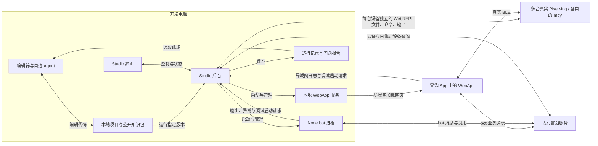

# PixelMug Developer Studio 整体架构设计

> 当前模块归属以 [SDK 与 Studio 边界](SDK-BOUNDARY.md) 为准：所有 Studio 专用接入均由 `tools/studio/runtime` 和 `devices` 承担。下述设备运行协议保持不变。

状态：整体方案已确认，各部分接口及实现细节待讨论。

项目位置：`tools/studio`。

已确认的 MPS 调试启动实现方案见 [MPS-LAUNCH-DESIGN.md](MPS-LAUNCH-DESIGN.md)：仅分流 `talMpyExecOneScript`；每轮先重启，通过 WebREPL 保留根目录 `boot.py` 和 `webrepl_cfg.py` 并清理其余文件，上传项目及统一引导程序后执行 `__main__.py`。设备启动部分按该专项文档实现了首版，当前实现与验证边界见 [LAUNCH-IMPLEMENTATION.md](LAUNCH-IMPLEMENTATION.md)。

基础工作台已实现登录、设备状态、项目目录浏览、运行控制及三端日志页面，启动方式见 [README.md](README.md)。账号接口与浏览器流程已通过自动化验证，真实账号与硬件验收待完成。

当前已实现 bot / WebApp 日志接收原型，运行方式见 [README.md](README.md)。包括 console 与未处理异常采集、bot IPC、WebApp 同源 HTTP 上报、本地日志文件和 PC 日志查看页；已增加设备 WebREPL 部署、MPY 日志及启动调用重定向原型；Git 检查点和便携环境包尚未实现，真机验收仍待完成。

本文取代此前的云端 Studio＋独立 Bridge 方案。首版采用“开发者自选编辑器与 Coding Agent＋本地 Studio＋真实设备”的架构，不建设 Studio 云端服务。

## 1. 产品定位

PixelMug Developer Studio 是运行于 Windows / macOS / Linux 的本机便携开发运行与调试工具，采用浏览器 WebUI＋本地后台，解压后启动。

开发者在 VS Code 等编辑器中，使用自己选择的 Coding Agent 编写完整 MPS 应用。Studio 负责在真实环境中运行应用、汇总 WebApp / bot / mpy 三端状态与日志、整理问题现场，再将现场交给原有 Agent 分析和修复。

核心循环：

```text
编辑器中与 Agent 对话并修改代码
             ↓
本地 Studio 运行三端应用
             ↓
开发者操作冒泡 App 和真实 PixelMug
             ↓
Studio 收集日志、异常及问题描述
             ↓
Agent 读取问题报告并修改本地代码
             ↓
再次运行并由开发者验证
```

Studio 首版不内置模型或 Agent 对话系统，不替代编辑器。它提供独立于特定模型和编码工具的运行、观察与问题反馈能力。

## 2. 已确认的设计原则

- 所有应用在真实运行环境中验证，不提供任何硬件模拟。
- WebApp 文件由开发电脑的本地服务提供，代码在冒泡 App 的 WebView 中执行。
- bot 在开发电脑上的真实 Node.js 环境中执行。
- mpy 在真实 PixelMug 中执行，不在电脑上执行。支持一个应用使用多台 PixelMug，Studio 同时管理各设备独立的 WebREPL 连接。
- 开发电脑、手机和 PixelMug 处于可互相访问的同一局域网；真实 BLE 交互另需满足蓝牙连接条件。
- 本地项目目录是源码的主工作区，开发者和 Agent 在编辑器中修改它。Studio 环境包包含 Git，可为开发者项目自动初始化本地仓库，并将版本历史关联到调试运行。
- 三端日志和问题报告由本地 Studio 收集、保存和展示，不要求上传自建云端。
- 不建设 Studio 云端代码平台、WebApp 静态托管、日志平台或 bot 容器托管。
- 不限定开发者使用特定 Coding Agent；具体工具接入能力分别验证。
- 对外提供构建后的 JavaScript SDK 包、API 文档、类型声明、示例、模板和开发规范，保留标准 import 用法；不发布内部 SDK 原始源码和 SDK source map，接受构建后 JavaScript 仍可被分析的边界。

本地架构不等于完全离线：冒泡认证、设备查询、bot 消息服务和正式 MPS 上传仍可能访问现有冒泡服务；开发者选择的 Agent 也可能访问其模型服务。

## 3. 系统组成与职责

| 部分 | 职责 | 运行位置 |
| --- | --- | --- |
| 编辑器与 Coding Agent | 浏览、编辑代码，生成应用，读取现场并修复 | 开发者选择的环境 |
| 公开开发知识包 | 提供版本对应的 API、协议、模板、示例和开发约束 | 本地开发环境 |
| Studio 界面 | 打开本地项目、查看绑定设备，控制调试，展示三端记录，生成问题报告 | 开发电脑 |
| Studio 后台 | 运行 bot、本地提供 WebApp、连接 WebREPL、执行任务、收集日志 | 开发电脑 |
| 冒泡 App | 管理已有账号、bot、MPS 和绑定关系；运行真实 WebApp | 手机 |
| PixelMug | 运行 mpy，提供真实显示、音频、按键、传感器和 BLE | 真实设备 |

### 3.1 编辑器与 Agent

以 VS Code 配合开发者自选 Agent 为典型使用方式，也允许其他编辑器或编码工具。

需求对话、源码浏览、编辑和修改审阅在此完成。Studio 不维护第二份可独立编辑的工作区，不要求开发者在编辑器与 Studio 之间手工上传源码。

编辑器、Agent 与 Studio 共用同一个本地项目目录。Studio 不提供代码编辑功能，只读取应用源码，并将日志、运行信息和问题记录写入项目的 `debug/` 目录。开发者和 Agent 直接在同一项目中读取这些文件，无需复制报告、上传源码或通过额外工具接口获取日志。首版不依赖 CLI、HTTP 或 MCP 作为 Agent 读取现场的通道。

### 3.2 公开开发知识包

公开资料至少包括：

- API 参数、返回值、异常、事件和类型声明。
- bot、WebApp、mpy 的标准工程模板。
- 应用启动、设备交互、BLE 协议及生命周期规范。
- 图形、音频、按键、传感器等经过验证的示例。
- 资源限制、兼容版本和常见问题诊断方法。

资料应标明对应 SDK / 固件 / 模板版本，避免混用历史示例。外部 Agent 应能依据公开资料完成应用，不依赖阅读内部实现。

#### SDK 分发原则（已确认）

首版采用“构建后的 SDK 包＋类型声明＋文档和示例”方案。内部继续维护 `mps/jeejio-bubble/sdk` 源码，对外提供独立、可安装的 JavaScript SDK 包，应用通过正常的 `import` 使用公开接口，不再引用内部仓库的相对路径。

- 发布运行所需的打包、压缩产物，对外 API 的 `.d.ts` 类型声明、包入口配置及使用说明。
- 不发布原始 SDK 源文件、内部工程结构、内部测试或 SDK source map；发布内容采用明确的文件白名单。
- 可按需混淆，但不将混淆作为不可逆的源码保护保证。
- bot 与 WebApp 使用独立的公开入口，避免浏览器端引入 Node 专用依赖。
- 包版本与公开文档、示例、模板保持对应，模板固定适用的依赖版本。
- 编辑器与 Agent 根据类型声明、文档和示例开发，不依赖阅读 SDK 内部实现。

包名及入口尚未定名，以下仅作使用形式示意：

```js
import { BubbleBot, InlineKeyboard } from "@jeejio/bubble/bot";
import { BubbleWebApp } from "@jeejio/bubble/webapp";
```

前一条用于 bot 工程，后一条用于 WebApp 工程。分发渠道可以是 npm 包仓库或可安装的包文件，具体渠道和访问权限后续确定。

此方案的目标是不交付内部原始源码和可维护的完整工程；开发者仍可获取、阅读和分析构建后的 JavaScript。私有包仓库只能限制下载权限，不能阻止获授权用户查看包内容。首版接受这一边界，不为保护 SDK 而引入原生 Node 扩展、独立运行服务或将现有逻辑迁入冒泡 App 原生层。

SDK source map 不对外分发，与应用调试需要保存 WebApp 业务代码的 source map是两回事。构建流水线应检查最终应用产物及 source map，避免其中意外包含内部 SDK 原始源码；SDK 内部错误可保留公开版本与构建位置供维护者排查。

固件内置的 mpy 能力继续以文档和 binding 接口对外提供，不随应用开发资料交付固件内部实现源码。

### 3.3 本地 Studio

对外是一个工具，内部包含界面和后台执行能力。原 Bridge 的职责合并到 Studio 后台，不再要求开发者安装、登录和配对两个独立产品。

后台承担：

- 打开本地项目，准备本次运行所需的代码版本及配置。
- 管理 Node 运行时、Git 和项目依赖，初始化或复用本地仓库，启动、停止和重启 bot。
- 启动本地 WebApp 服务，提供手机可访问的局域网地址。
- 接收 WebApp 日志，以及 WebApp 和 bot 发起的调试启动请求，保持正式 SDK 的调用契约。
- 重启、查询 WiFi、启动 REPL 的辅助 RPC 统一由本地 bot 执行；WebApp 仅发起启动与订阅事件，已受理任务及设备重跑不依赖手机保活。
- 同时管理多台设备的 WebREPL，按目标设备重启、同步文件和执行 mpy 入口。
- 保存三端日志、进程状态、设备连接状态及运行记录。
- 为界面和后续 Agent 接入提供统一的本地调试能力。

### 3.4 产品形态与便携交付（已确认）

首版采用本机便携版：WebUI＋本地后台，支持 Windows、macOS、Linux。开发者下载与系统及 CPU 架构匹配的压缩包，解压到可写目录后运行启动入口，由后台自动打开电脑浏览器中的 Studio WebUI。

Studio 是纯 PC 工具，不提供移动版 Studio。首版不采用 VirtualBox 虚拟机镜像或要求用户安装容器运行环境，也不引入独立桌面 WebView 外壳。浏览器负责界面，本地后台负责环境和调试任务。

#### 启动与环境

启动流程：检查随包运行环境 → 启动本地后台 → 自动打开本机浏览器 → 打开共享项目目录 → 登录冒泡账号并获取绑定设备状态 → 等待应用调用触发设备调试。

- 便携包包含预先构建的 WebUI、后台程序、所需 Node 运行时及包管理工具、Git 和必要运行依赖。
- 运行 Studio 自身不要求开发者预装 Node / Git、执行依赖安装或编译界面；用户项目首次安装依赖仍可能需要联网。
- 工具使用包内运行环境的明确路径，不修改系统 PATH，不注册系统服务，不要求以管理员身份运行。
- 默认不配置开机自启。后台在开发者主动启动后运行，与浏览器页面的生命周期分开。
- 环境检查失败时显示具体缺失或不兼容项。系统首次运行提示、局域网防火墙访问和可执行权限仍需按平台处理，免安装不代表完全没有系统交互。

#### 便携包组成

以下为逻辑结构，启动入口及具体目录名待实现确定：

```text
pixelmug-studio/
├── 启动入口              # 按操作系统提供
├── app/
│   ├── server/           # 构建后的本地后台
│   └── web/              # 构建后的 Studio WebUI
├── runtime/
│   ├── node/             # Node 及包管理工具
│   └── git/              # Git 及必要运行文件
├── licenses/
└── version.json
```

一套应用代码和构建流程，按平台与 CPU 架构组合所需运行文件并输出压缩包，不维护多个安装向导。免安装不等于一个二进制包覆盖所有平台；具体支持的系统版本、Linux 发行版基础及架构矩阵需验证后明确。

首版以完整便携包为目标，不以首次启动自动下载 Node / Git 为必需步骤。Git 的跨平台运行文件和依赖是重点验证项。Node 后台与 Vue WebUI 可优先复用现有技术经验，框架和版本另行确定。

#### PC 管理界面与被测应用通信

- Studio WebUI 仅供开发者在电脑浏览器访问，本地管理入口默认绑定回环地址。
- 手机冒泡 App 访问的是开发者 MPS 的 WebApp，由电脑上的应用服务提供，不是 Studio 管理页面。
- 被测 WebApp 的调试 SDK 经局域网向 Studio 后台发送日志和受限启动请求；这是应用与调试后台的通信，不是移动端 Studio 产品入口。
- 后台将本机管理能力与局域网调试能力分开，只向手机开放必要的应用资源和调试接口。PC 管理界面仅监听回环地址；局域网能力统一由 `pixelmug-studio.local:7979` Gateway 提供，单次运行接收端也仅监听回环地址。
- 本地项目直接由后台访问，编辑器、Agent 与 Studio 共用原项目目录及 `debug/`，不经浏览器上传，也无需虚拟机共享目录。

#### 进程生命周期

- 关闭浏览器标签页不停止 Studio 后台，也不自动结束 bot 或真机调试；重新打开页面可恢复查看运行状态。
- WebUI 提供明确的退出操作，后台保存记录、停止其管理的本地子进程并关闭连接。
- 是否终止设备应用及如何确认，遵循设备控制流程；断开 WebREPL 不能报告为 mpy 已停止。
- 重复启动优先定位并打开已有实例，避免后台互相争抢端口、bot 和设备。单实例范围和多项目管理细节待定。
- 后台与被测 bot 分为独立进程，bot 异常退出不应使 Studio 失去日志展示和恢复能力。跨平台子进程树清理需验证。

#### 数据与升级

工具目录与开发者项目分离。源码、Git 仓库和 `debug/` 保留在项目中；Studio 偏好、登录信息及运行缓存放置位置另行设计，不能因更换便携包而丢失项目记录。

首版可通过退出旧版本、解压并启动新版本完成升级，不要求自动更新器。需保留必要的配置迁移和版本兼容检查，不在升级时覆盖应用源码或历史日志。

交付验证至少覆盖：在未预装 Node / Git 的受支持系统上解压启动 WebUI、打开项目、调用随包 Git、启动 bot、提供局域网 WebApp，以及连接多台设备 WebREPL。

## 4. 整体连接架构



WebApp 的业务消息仍遵循冒泡 SDK 现有链路，本地日志接口不替代 bot 通信协议。

## 5. 账号、项目和设备

### 5.1 冒泡 App 负责的事项

开发者在冒泡 App 中完成：

1. 创建 bot，获取 bot token。
2. 创建 MPS，获取 MPS ID。
3. 绑定 PixelMug。

Studio 不提供上述创建、注册或绑定流程。

### 5.2 Studio 使用已有资源

- 使用冒泡用户 ID 和验证码登录，具体验证码获取方式、有效期和认证接口待确认。
- 登录后自动获取并维护当前用户绑定的所有在线设备列表，无需用户在 Studio 中选择或勾选调试设备。
- 设备云端在线与本地 WebREPL 可连接是不同状态，应分别展示。
- 使用已有 bot token、MPS ID；如何输入、读取及保存凭据待设计，不假定登录后自动取得 bot token。
- bot 定义设备角色、数量和槽位，用户在冒泡 App 中动态完成 MPS 的设备绑定；SDK 在运行时取得实际设备对象。Studio 不维护另一套 MPS 设备绑定关系。
- 打开项目不会自动重启设备。设备离线不影响开发者继续编辑代码或查看历史报告。

### 5.3 多设备应用（已确认）

首版必须支持多设备应用，以 `mps/block-drop-battle` 为代表：该应用要求两台不同的 PixelMug，对应两位玩家及两个设备槽。Studio 不能将连接、启动或日志模型限制为单设备，也不提供独立的调试设备选择流程。

- 一次调试会话包含一个项目及多个由 SDK 调用指定的目标设备；记录调用携带的设备槽、真实设备身份和当前连接地址用于执行与日志关联，不在 Studio 中配置业务槽位映射，不能仅按 IP 或设备名称识别。
- 每台设备独立连接和认证 WebREPL，维护重启、传输、运行、断连及重连状态。单设备只允许一个 WebREPL 客户端，不妨碍 Studio 同时连接多台设备。
- 根据调用的真实目标分别启动对应设备，不将一次单设备调用隐式广播到所有杯子。
- 支持查看各设备状态和日志，以及一次多设备运行的整体进度；整体就绪需满足应用必需设备的就绪条件，部分失败不能标记为全部成功。
- 支持按设备处理重连和失败；单设备重试是否需要整组重新运行，应遵循应用要求，策略待细化。其他设备日志不能因一台设备断开而停止采集。
- 同一设备的冲突任务需串行或互斥，不同设备的操作可独立调度。具体并发上限和带宽控制待实测。
- 支持来自多个手机 / WebApp 会话的调试记录，关联调用者、设备槽与目标设备。

单设备和多设备使用相同的校验规则：Studio 根据每次 `talMpyExecOneScript` 调用携带的实际设备标识确定目标，只检查该设备是否与当前登录用户有绑定关系、是否在线。符合两项条件即可进入专用启动流程，不需要额外选择或本地逐台授权；不符合则返回明确错误，不执行重启、清理或上传，也不回退到正式安装路径。业务槽位和 MPS 绑定仍由 bot 与冒泡 App 管理，不能将槽位配置或局域网可达性当作用户绑定关系的证明。未绑定在当前登录用户下的设备，即使属于应用中的其他玩家，也不通过此校验。

设备列表及在线状态随冒泡侧绑定和状态变化更新，发起新启动或重新运行时按当前绑定关系及在线状态校验；具体查询接口、刷新和缓存策略后续细化。主动重启后的短暂离线由启动流程等待恢复，不应被误判为用户解绑。

基础工作台已接入手机号 / 邮箱验证码登录及自动设备查询，每次启动按 CreatorHub 返回的绑定关系与在线状态进行校验。旧命令行接收端仍使用 `--devices` 指定的 `devices.local.json` 临时检查 `deviceId + slotId`；该兼容模式不验证真实账号绑定或在线状态。工作台无需手工列表，真实接口及硬件验收待完成。

## 6. 本地项目与运行版本

### 应用组成（已确认）

项目根目录必须包含 `bot/`，WebApp 与 MPY 是可选部分，分别使用固定的 `webapp/` 和 `mpy/` 目录，支持 `bot`、`bot + WebApp`、`bot + MPY`、`bot + WebApp + MPY`。开发者必须在 Studio 中指定 `bot/` 内的 JavaScript 入口。存在 `mpy/` 时，打开项目阶段即要求 `mpy/__main__.py` 和合法 JSON 对象格式的 `mpy/mps.json`；缺少任一文件都拒绝打开。没有 MPY 时不影响 Bot 或 WebApp 运行。界面按实际目录组成显示运行状态。 运行设置提供“启动后自动运行设备代码”选项，默认关闭；开启后，Studio 在恢复在线设备绑定并完成 Python Dev 准备后，主动为每台绑定设备创建一次 MPY 部署任务。失败不自动循环重试。


项目模板按需包含 `bot/`、`webapp/`、`mpy/`，并使用 `debug/` 作为 Studio 保存本地调试记录的统一位置。下面展示三端完整项目的布局，`webapp/` 和 `mpy/` 可省略。

```text
my-mps-app/
├── bot/                 # bot 代码
├── webapp/              # WebApp 代码及资源
├── mpy/                 # 设备端代码及资源
└── debug/               # Studio 写入，编辑器和 Agent 直接读取
```

职责明确分开：开发者和 Agent 修改应用代码，Studio 读取代码进行运行和调试，并负责写入调试记录。Studio 没有代码编辑功能，不建立另一份可独立编辑的源码工作区。运行所需配置由 Studio 读取或管理，不把凭据写入生成源码、聊天或日志。

### debug 目录组织

按每次运行分目录，避免三端不同版本的日志混在一起。以下是建议布局，具体文件名和字段后续确定：

```text
debug/
├── README.md            # 说明日志阅读方式
├── latest.json          # 指向最近一次运行，不复制历史日志
└── runs/
    └── <run-id>/
        ├── run.json     # Git / 源码版本、设备集合、槽位及运行状态
        ├── bot.log
        ├── webapp.log
        ├── devices/
        │   └── <device-id>/
        │       └── mpy.log  # 每台设备单独保存
        ├── studio.log   # 构建、传输、重启及连接过程
        └── issues/      # 可选：用户描述、现场范围和效果附件
```

- 日志使用编辑器和 Agent 可直接阅读的文本格式，具体采用普通文本还是 JSON Lines 待细化。
- Studio 持续落盘已收到的日志；界面展示同一批记录，关闭界面不应丢失已保存的现场。
- 开发者可直接告诉 Agent“查看 debug 中最新一次运行，分析 mpy 的错误”，也可以明确指定历史运行 ID。
- 新运行使用新目录，保留旧现场；`latest.json` 只作为发现入口，不替代明确的运行标识。Agent 分析时应记录所读取的 run ID。
- Studio 写入，开发者和 Agent 读取；排查问题时不改写原始日志。涉及完整快照的读取、元数据更新及保留清理策略后续设计。
- `debug/` 不作为应用源码参与 WebApp 分发、mpy 文件同步或正式 MPS 打包；模板默认将生成的调试数据排除在版本控制之外。
- 日志不保存 bot token、WebREPL 密码等凭据。源码快照及报告只收集项目相关内容，不递归纳入 `debug/`。

### 本地 Git 仓库（已确认）

Git 是 Studio 便携环境包的一部分，在 Windows / macOS / Linux 上提供受支持的 Git 工具链，不以用户另行安装 Git 为前提。各平台运行依赖、版本和升级策略待验证。

- 打开或创建开发者项目时，如果尚未处于 Git 仓库中，Studio 自动初始化本地仓库，并建立可回溯的初始项目版本。
- 已处于仓库、父级仓库或 worktree中的项目复用现有版本管理，不覆盖历史，不擅自创建嵌套仓库或修改用户全局 Git 配置。
- 本地仓库供编辑器、Agent 和 Studio 共同使用，支持追踪代码变化及恢复历史代码。不要求配置远程仓库，不自动推送。
- 每轮运行记录仓库 / 项目位置、commit、工作区是否有未提交修改，以及此次实际执行代码的可还原快照。未提交文件、未跟踪的应用文件和已删除文件必须纳入运行版本判断，不能仅记录 HEAD。
- Studio 可建立本地运行检查点；使用提交、独立引用还是快照加差异来保存待设计。版本留存不能覆盖用户暂存区、切换其工作分支或与 Agent 的 Git 操作互相踩踏。
- 保留 `debug/` 日志在本地文件系统，默认不提交生成日志、依赖目录、构建产物和凭据。源码检查点不递归包含 `debug/`。
- Agent 可依据日志中的 Git / 检查点信息定位当时代码。恢复代码应作为显式操作，先保护当前未保存的工作，不在运行失败时自动回退或重置用户文件。

仓库初始化和版本元数据维护不属于代码编辑器功能，Studio 仍不提供业务源码编辑。

### 运行与代码关联

每次调试建立运行记录，至少关联：

- 本地项目及本次源码快照或可还原的版本。
- 构建 / 运行 ID与三端实际加载的版本。
- 各目标设备身份、业务角色 / 槽位映射、实际加载的构建，以及 SDK、固件等可获得的版本信息。
- 启动过程、状态、日志和问题反馈。

日志对应发生问题时的代码，不能在本地文件修改后指向错误版本。记录应支持未提交的本地修改，不能只依赖 Git commit。

Studio 不自动覆盖编辑器中的代码。首版以显式重新运行为基准，避免自动热更新造成代码与日志版本不一致；具体开发服务器及热更新策略待讨论。

## 7. 三端运行方式

### 7.1 bot

Studio 在本机启动真实 Node bot 进程，配置其使用本地 WebApp 地址，并收集 stdout、stderr、启动错误、退出码和重启状态。

Node 运行时及包管理工具随 Studio 便携包提供，项目依赖管理由 Studio 尽可能自动处理，不要求普通开发者手动搭建完整环境。Node 版本及用户项目依赖的兼容策略待定。

同一个 Bot ID 的开发进程与正式进程应避免同时轮询，具体检查及互斥策略待设计。Node 子进程不提供容器级隔离，执行权限和工作目录边界需明确。

### 7.2 WebApp

WebApp 由电脑通过 `http://pixelmug-studio.local:7979/app/<projectKey>/` 提供局域网服务。该地址交给 bot，用户通过冒泡 App 中的入口打开。

Studio 内置 mDNS 响应器，将 `pixelmug-studio.local` 发布到当前所有非回环 IPv4 网卡，不要求开发者选择或填写局域网 IP。页面打不开时，提供同一局域网、TCP 7979、UDP 5353、防火墙和网络隔离等连接诊断。

网页资源在电脑，JavaScript 在手机冒泡 App 中执行。无需上传 Studio 云端，无需为日常调试配置公网域名或云端 HTTPS 托管。

Studio 主进程提供长期存在的 WebApp Gateway，首版固定监听 `7979` 端口。冒泡卡片统一使用 `pixelmug-studio.local:7979`；同一 Studio 进程和同一项目生成的 URL 保持不变。单次运行内部继续使用独立的随机端口、`runId` 和凭据，Gateway 将固定入口转发到当前运行，避免运行隔离信息进入卡片 URL。

项目首次生成不可猜测的本地入口标识和 WebApp 凭据，并在 Studio 进程生命周期内复用。停止智能体时 Gateway 保持监听，旧卡片显示“智能体尚未运行”；再次启动后旧卡片重新指向当前 WebApp。切换项目使用不同入口标识，旧项目卡片不能打开当前项目。HTML、调试配置和应用资源禁用缓存。Studio 进程退出后 mDNS 公告和 Gateway 同时停止；重新启动 Studio 后需要重新获取项目入口。

### 7.3 mpy

mpy 在各台真实 PixelMug 中运行，Studio 通过每台设备独立的 WebREPL 控制并获取输出。以下重启和同步流程按目标设备执行，多设备整体操作由同一调试会话协调。

每次设备重新运行采用整机重启：

1. 保存上一轮日志，结束原设备运行记录。
2. 确保设备下次启动进入 REPL 模式，执行重启。
3. 等待联网与 WebREPL 恢复，重新连接并认证。
4. 同步源码及资源，校验完成后设置工作目录和模块搜索路径。
5. 执行 `__main__.py`，确认应用就绪并持续采集输出。

源码传输允许两种方案，待实测选型：整包传输后设备解压，或逐文件传输。两者都是调试文件同步，不是正式 MPS 安装，不要求上传发布服务。应清理本项目已删除的旧文件，保留 REPL 启动配置，并在全部文件就绪后运行。

执行应保留真实文件名和行号。原生模块阻塞、重启恢复、BLE 与 WebREPL 同时运行等仍需真机验证。

## 8. 调试启动调用透明重定向（已确认）

无论 WebApp 还是 bot 调用 `talMpyExecOneScript`，正式和调试模式对应用必须提供完全一致的公开调用行为与返回契约。应用代码、Loading、bot 业务处理不编写调试专用分支，由 Studio 是否加载运行适配层决定执行后端。

| 调用方 | 正式模式 | 调试模式 |
| --- | --- | --- |
| WebApp | 通过现有 JeeWeb / 冒泡链路调用真实设备 RPC | Studio 适配层将调用转到本地 Studio，由 Studio 执行 WebREPL 调试启动并按原契约回传 |
| bot | 通过现有 bot SDK 设备调用链路调用真实设备 RPC | Studio 适配层将调用转到本地 Studio，采用相同调试执行后端并保留 bot 侧原有返回与事件契约 |

“完全一致”以各调用入口的正式可观察契约为基准，不是强行让原本不同的 WebApp / bot 返回封装变成一种结构，也不要求调试传输耗时与正式下载相同。需要逐项覆盖：

- 方法名、参数、目标设备、群组 / 会话及设备槽等路由语义。
- 原返回结构、返回码及“已接受”“准备中”“切换中”“已运行”等状态的含义。
- Promise 完成 / 拒绝、回调和异步调用完成事件的语义。
- 应用依赖的进度、运行就绪、失败、设备通知及其顺序和关联标识。
- 超时、参数错误、设备不可用、启动失败、重复请求等异常行为。

不能一律等到运行结束才返回成功，或一律返回 `264` 来绕过正式异步流程。SDK / Studio 应依据实际调试任务状态产生契约对应的结果和通知；未完成启动不得报告设备已运行。正式安装事件如对应用可见，需明确映射到真实调试准备阶段并保持公开含义，不能要求应用因调试而改写事件处理。

### 实现边界

- Studio 适配层在调用发往真实设备之前分流，覆盖 WebApp 和 bot 的公开调用入口（包括同步响应、异步请求及完成通知的相关路径）。不修改无关设备 RPC，不要求设备收到调用后转发 Studio。
- Studio 维护统一启动任务状态，再由Studio 两端适配器按原通道向调用方交付结果和事件。
- 正式模式继续走原设备路径，不依赖本地 Studio 在线；调试服务不可用时明确失败，不自动回退到正式安装。
- 调试请求关联项目、运行、构建、调用来源、目标设备与槽位。Studio debug run 模式忽略 `talMpyExecOneScript` 的 MPS ID / 版本参数（包括缺失、为空或不匹配），始终部署当前调试会话关联的本地项目 `mpy/`；项目、设备、槽位及权限仍须校验。正式模式保持原有参数处理。
- WebApp 和 bot 对同一设备、同一构建的重复启动请求应复用同一任务，并向各调用方正确反馈。不同设备分别路由，不同构建冲突需明确处理，不能重复重启或误启动另一台设备。
- Studio 的手动重新运行与 SDK 启动请求复用同一任务协调能力。显式重新运行仍按已确认方案重启对应设备；同版本重复请求不等同于显式重新运行。

后续先梳理正式 RPC 与 SDK 入口的完整状态、返回及通知契约，再确定 Studio 映射，并用单设备和 `block-drop-battle` 双设备场景验证两种模式可无缝切换。首版实现状态及尚待真机验证的边界见 [LAUNCH-IMPLEMENTATION.md](LAUNCH-IMPLEMENTATION.md)。

## 9. 日志采集与 SDK 支持

在 `mps/jeejio-bubble/sdk` 中增加可选调试支持。正常版本默认关闭，本地调试配置提供 Studio 地址、会话、构建信息及受限凭据。

### 9.1 WebApp

- 转发 console 日志并保留原本地输出。
- 捕获未处理 JavaScript 错误和 Promise 异常。
- 记录 SDK 中 bot / 设备 / BLE 关键调用及结果。
- 经局域网直接发送到本地 Studio，无需云端转发。
- vConsole 可选保留作手机现场查看，Studio 是主要汇总入口。
- 保存对应 source map以定位开发源码；组件应尽早初始化，但页面未加载时不能依靠它上报。

### 9.2 bot

- Studio 捕获进程 stdout / stderr，包括 SDK 初始化之前的失败。
- Studio 运行层为 console 补充调试会话及结构化上下文；通用 SDK 不依赖 Studio。
- 两种采集方式应统一处理，避免同一记录重复上报。
- 进程退出、停止及重启状态由 Studio 独立记录。

### 9.3 mpy

- 通过 WebREPL 收集 Python print 输出和未捕获异常堆栈。
- 业务调试信息由开发者或 Agent 在代码中主动添加。
- 被应用捕获的异常需要应用主动记录。
- 不默认覆盖底层 ESP 日志、C/C++ 输出、固件崩溃现场或断线期间日志。

### 9.4 共同约束

日志至少关联来源端、会话、构建、Git / 源码检查点和运行 ID。设备相关日志必须包含真实设备身份及业务槽位，多手机场景同时标记 WebApp 会话。跨端操作使用关联 ID，不能只依赖不同设备时钟。

采集需要有限缓存、批量异步发送、大小限制、敏感字段过滤和明确的丢失提示。日志上传失败不能递归产生无限日志，也不能阻塞业务。

首版不建设远程单步调试、任意变量查看、屏幕传输或复杂固件诊断平台。

### 9.5 替换现有 CloudLog（已确认）

需要清理 `mps/jeejio-bubble/sdk` 现有 CloudLog 相关代码，替换为面向本地 Studio 的 debug 支持，不并行维护两套默认日志体系。

计划范围：

- 清理 `CloudLog.js`、`CloudLog` / `loadCloudLogConfig` 等公开导出及相关加载、配置和自动注入路径。
- 迁移引用旧 CloudLog 的 SDK 调用点、示例、模板、测试、配置说明和公开文档，避免发布包残留不可用入口。
- 检查旧日志服务的配置、环境变量及依赖；仅由 CloudLog 使用的依赖随迁移移除，共用依赖在核实其他用途后处理。
- 新 debug 支持统一承接 WebApp console / 异常、bot console / 调用上下文、局域网上报、会话关联及透明启动重定向。
- 保留正常 console 输出；正式模式不开启 Studio 调试支持时，不依赖 Studio 或旧云日志服务。
- 明确 SDK 版本变更与旧接口迁移说明，更新对应类型声明及打包入口。

CloudLog 已清理；Studio 日志采集、传输及启动分流均归属 `tools/studio/runtime`，详见 [边界拆分](SDK-BOUNDARY.md)。

## 10. Studio 界面与问题反馈

Studio 界面聚焦：

- 打开本地项目，配置已有 bot / MPS。
- 登录冒泡账号，自动展示绑定设备及在线状态，分别查看应用调用所涉及设备的本地连接；不提供设备选择或业务槽位配置。
- 启动、停止、重新运行，展示各阶段进度。
- 查看 WebApp、bot、mpy、BLE 的分别状态及实际版本。
- 按运行、设备 / 槽位、来源、级别筛选日志，搜索异常并关联 Git 检查点定位源码。
- 将问题现场保存到共享项目的 `debug/` 目录，供编辑器和 Agent 直接读取。

代码浏览和编辑在编辑器中完成，Studio 不提供代码编辑功能。Studio 可提供错误源码位置和打开编辑器入口，具体集成待定。无日志不代表应用正常，断线也不代表设备程序已停止。

问题记录保存在 `debug/` 对应运行目录中，包含预期与实际表现、关联代码、三端日志范围、异常和环境信息，可附加照片、录音等效果证据。运行仍在产生日志时，问题记录应固定关联的时间范围或现场快照，不能随新日志改变。Agent 直接读取本地文件；具体报告格式后续设计。

修复后生成新运行记录，由开发者确认效果。区分“已修改”“待验证”“已解决”，保留原现场及后续反馈。

## 11. 网络、凭据和生命周期边界

- 调试接口监听局域网时应校验会话凭据，只允许当前项目内、目标与登录用户绑定且在线的受限设备启动操作，不暴露任意命令执行接口。
- WebApp 获得的是受限调试授权，不应获得 bot token或 WebREPL 密码。
- 本地凭据存储、日志过滤、应用退出及子进程收尾策略待设计。
- 电脑或 Studio 不在线时，本地 WebApp 服务、bot 运行及设备控制不可视为可用；已收到的日志应保留。
- WebREPL 连接丢失后是否仍在运行 mpy需明确显示未知，停止操作要区分请求发出与已确认停止。
- 每台设备的 WebREPL 只允许一个客户端；Studio 可同时持有多台设备的连接，并分别处理其他终端占用。
- 当前 REPL 与 MPS 共用 `mpy` 分区，正式安装可能格式化并删除开发文件；本地源码是保留依据。

## 12. 正式发布边界

日常调试不要求 MPS 包云端上传，也不要求公网 WebApp 部署。

正式发布时，开发者另行准备：

- 用现有打包工具生成正式 `.mps` 包，并上传现有 MPS 服务。
- 按正式流程在真机安装验证。
- 把 bot 部署到自行维护的常驻 Node 环境。
- 把 WebApp 部署到用户可以访问的正式地址，并更新 bot 配置。

Studio 后续可复用打包上传工具、提供部署辅助，但首版不承担生产托管或保证电脑关闭后应用服务持续可用。

## 13. 后续逐项讨论顺序

本文确定职责及数据流，不提前锁定具体实现。

1. 在已确认的本机便携 WebUI＋后台形态下，细化界面结构、启动入口及平台运行包。
2. 项目识别、配置、Node / Git 环境包、本地仓库及运行检查点、WebApp 启动管理。
3. 冒泡登录、用户绑定设备及在线状态查询、调用目标校验及多路 WebREPL 连接。
4. 整机重启、REPL 恢复、文件传输、入口执行及应用就绪。
5. SDK CloudLog 清理与 Studio debug 替换，bot / WebApp 透明启动契约及失败恢复。
6. `debug/` 目录格式、运行版本关联、三端日志、问题记录及保留策略。
7. 正式打包上传和部署辅助。

## 14. 参考与文档关系

此前的 [UI-FRAMEWORK.md](UI-FRAMEWORK.md) 基于云端 Studio 和内置 Agent，已不适用于本方案，保留为历史讨论稿，界面需按本地架构重新设计。

可复用的现有实现：

- [MPS 开发指南](../../mps/how-to-dev-mps-apps.md)
- [Bubble SDK](../../mps/jeejio-bubble/sdk/)
- [双设备对战应用](../../mps/block-drop-battle/)
- [WebApp 启动框架](../../mps/audio-visualizer/webapp/src/template/mpsLaunch.ts)
- [WebREPL 工具](../pixelmug_webrepl/README.md)
- [WebREPL 客户端](../pixelmug_webrepl/src/extension.ts)
- [MPS 打包工具](../mps_pack/README.md)
- [VM 与 REPL 生命周期](../../components/mpy_vm/mpy_vm.c)
- [REPL 设备接口](../../main/PixelCup/service/mpyVM/repl/talMpyStartREPL.cpp)
- [开发模式初始化](../../components/mpy_vm/mpy/ports/esp32/modules/_boot_dev.py)
- [正式安装流程](../../components/mpy_vm/mpy/ports/esp32/modules/install_mps/install_app.py)

## Studio 专用设备启动模式

MPY 调试使用新增 `talMpyRebootStartREPL(requestId)` 和 `talMpyGetStudioState()`，均经本地 bot 调用。固件以一次性启动请求进入 MpyReplMode：跳过动画和 Home，静态 Python Dev → 静态 LOADING → 用户 MPY 覆盖显示缓冲。旧手动 WebREPL 入口不变。完整流程和修改清单见 [STUDIO-REPL-MODE.md](STUDIO-REPL-MODE.md)。


## 无需安装 RPC 的首次设备运行

Studio 调试环境启动后，Studio 的 bot 适配器恢复项目内已保存的会话查询线索，调用现有 `getBoundDevices` 从 `/bot/detail` 查询实际绑定；有结果则注册设备执行上下文，无结果等待用户绑定。首次没有会话线索时，普通会话消息即可触发查询。`sendBindDevice` 保持发送卡片的行为，完成绑定后的 `message:bind_device` 触发重新查询，开发者的原事件监听继续执行。

绑定设备与部署任务分开维护。PC 页面可以对尚未创建 launch 的绑定设备执行“运行 MPY”；服务端 `runBinding` 根据 bot 注册的上下文进入原部署流程，每次运行重新校验账号授权及 bot 绑定。应用主动调用 `talMpyExecOneScript` 仍兼容原去重逻辑。

新增内部控制操作：仅 bot 可以调用 `bindingScopes` 读取本 bot 的会话线索、`syncBindings` 同步某会话的完整绑定快照。成功空快照移除绑定及执行上下文，失败查询不发送空快照。已知会话每 15 秒刷新；同一作用域的查询串行，避免旧响应覆盖新绑定。

新增代码：Studio `runtime/StudioBindings.js` 管理发现和恢复，`StudioLaunch.js` 维护稳定的绑定订阅；Studio `bindings.mjs` 管理绑定列表与 `debug/studio-binding-scopes.json`。磁盘仅存会话线索及 bot 身份摘要，不保存 token 或可直接复用的设备绑定。启动恢复必须重新查询服务端。两端其它业务接口和固件无需因此改变。
